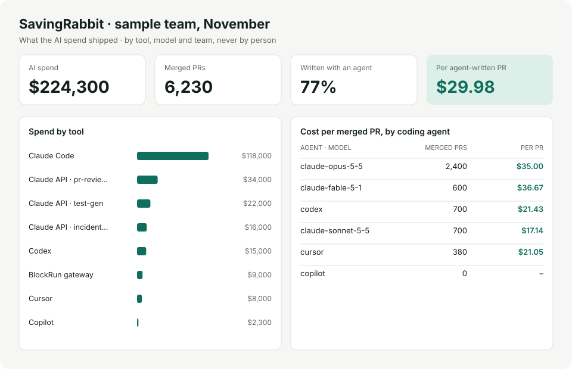

<div align="center">


<h1>SavingRabbit</h1>

<p><strong>What your AI coding spend shipped, and where to save.</strong><br>
Claude Code, Cursor, Codex and Copilot cost per merged pull request, by model and team.</p>

<h3>Stop paying Opus prices for Sonnet work.</h3>

<p>Your team pays Anthropic, OpenAI, Cursor and GitHub for AI.<br>
Each bill tells you what you spent. None of them tells you what it bought.<br><br>
<strong>SavingRabbit joins the bills to the pull requests that merged, and prices every one.</strong></p>

<br>

&nbsp;
&nbsp;
&nbsp;
&nbsp;
&nbsp;
&nbsp;


[](LICENSE)
[](https://python.org)
[](#connect-your-tools)
[](#connect-your-tools)
[](#connect-your-tools)
[](#connect-your-tools)

<br>



<sub>Illustrative data from <code>savingrabbit.py demo</code>. Your numbers come from your own keys.</sub>

<table><tr><td align="center">
<h2>💸 $42,840 a month back · 19% of the AI bill</h2>
<sub>In the sample team: the Opus work that Sonnet handled just as well in replay, moved to Sonnet.<br>Same merged work, same quality bar. Illustrative data from <code>savingrabbit.py demo</code>; run it on yours.</sub>
</td></tr></table>

</div>

> **Most AI coding spend goes to the most expensive model by default, including the work a cheaper one ships just as well.** SavingRabbit finds that work, proves it on your own tasks, and routes it to the cheaper model.
>
> **SavingRabbit** measures the ROI of AI coding tools. It is a one-file, read-only command-line tool for tracking Claude Code cost, Cursor usage, Codex and OpenAI spend, and GitHub Copilot seats against the work they ship. It pulls spend from each vendor's own admin API, reads which agent and model wrote each merged PR from the trailers your agents already leave in git, and reports cost per merged PR by tool, model and team. It runs on your machine, sends nothing anywhere except to the vendors you point it at, and never ranks individual people.

---

## Why this exists

AI coding spend grew faster than anyone's ability to explain it. Finance sees one number per vendor. Engineering sees the tools getting better. Nobody sees the middle: *this much spend, on this model, in this team, turned into this much merged work.*

The data for that middle already exists, in pieces:

- **Spend** sits in each vendor's admin API: Anthropic, OpenAI, Cursor and GitHub all publish one.
- **Authorship** sits in git. Claude Code writes `Co-Authored-By: Claude Opus 5.5 <noreply@anthropic.com>` on every commit it makes, and agents name their branches.
- **Outcome** sits in GitHub: the PR merged or it didn't.

SavingRabbit is the join. It deliberately stops there, at a number you can check, rather than trying to score productivity.

---

## Try it in 60 seconds

No keys needed. This writes an illustrative dataset and draws the dashboard above.

```sh
git clone https://github.com/BlockRunAI/savingrabbit && cd savingrabbit
python3 savingrabbit.py demo --since 2026-11-01 --until 2026-11-30
python3 savingrabbit.py report
python3 savingrabbit.py dashboard --out savingrabbit.svg
```

```
AI spend $224,300.00 · 6230 merged PRs · 77% written with an agent · $29.98 per agent-written PR

| Coding agent · model | Spend      | Merged PRs | Cost per merged PR |
| claude-opus-5-5      | $84,000.00 | 2400.0     | $35.00             |
| claude-fable-5-1     | $22,000.00 | 600.0      | $36.67             |
| codex                | $15,000.00 | 700.0      | $21.43             |
| claude-sonnet-5-5    | $12,000.00 | 700.0      | $17.14             |
| cursor               | $8,000.00  | 380.0      | $21.05             |
```

---

## Just you? No keys needed

If you use Claude Code yourself, see what your own spend shipped in one command. SavingRabbit reads only the token counts in Claude Code's local session logs, never your prompts or outputs. It prices them at list price from BlockRun's public model catalog, and joins them to your own commits in the repos you name.

```sh
python3 savingrabbit.py pull-local --since 2026-11-01 --until 2026-11-30 --repo ~/code/app --repo ~/code/api
python3 savingrabbit.py report
```

```
AI spend $412.30 · 64 landed commits · 89% written with an agent · $7.24 per agent-written commit
```
<sub>Illustrative numbers.</sub>

A commit counts as agent-written if a trailer names the agent, or if Claude Code ran in that repo that day. The second rule covers teams that strip co-author trailers. If you're on a Claude subscription, you pay a flat fee, so read the number as what the same work would cost on the API.

---

## Connect your tools

Each source is one command and one read-only credential. Connect only what your team uses: the report works with any subset.

| Source | Command | Credential (env var) | What it gives you |
|---|---|---|---|
| **Claude Code** | `pull-claude-code` | `ANTHROPIC_ADMIN_KEY`: Admin API key from the Claude Console | Cost per person, per day, per model ([docs](https://platform.claude.com/docs/en/manage-claude/claude-code-analytics-api)) |
| **Claude API** (your own bots and tools) | `pull-anthropic-api` | `ANTHROPIC_ADMIN_KEY` | Cost per workspace and model. Give each internal tool its own workspace and it shows up by name ([docs](https://platform.claude.com/docs/en/api/usage-cost-api)) |
| **OpenAI / Codex** | `pull-openai --label proj_abc=Codex` | `OPENAI_ADMIN_KEY`: organization Admin key | Cost per project and line item; label the project Codex bills to |
| **Cursor** | `pull-cursor` | `CURSOR_ADMIN_KEY`: team Admin API key | Every usage event with the cents charged ([docs](https://cursor.com/docs/account/teams/admin-api)) |
| **GitHub Copilot** | `pull-copilot --org your-org --seat-price 19` | `GITHUB_TOKEN` with org Copilot billing read | Seats × your plan's seat price |
| **BlockRun gateway** | `pull-blockrun --wallet 0x…` | none | Spend per model for a paying wallet |
| **Your own LLM proxy** (LiteLLM, nginx, an internal gateway) | `import-log --file calls.jsonl` | none | Every call tagged by the client that sent it ([see below](#which-tool-made-the-call)) |
| **GitHub** (the outcome side) | `pull-github --repo org/app` | `GITHUB_TOKEN`, read-only | Merged PRs and the agent and model that wrote each one |

Every `pull-*` command takes `--since` and `--until` (`YYYY-MM-DD`, UTC) and writes JSONL to `./savingrabbit-data/`. Re-running a source replaces that source's rows and leaves the others alone.

```sh
export ANTHROPIC_ADMIN_KEY=sk-ant-admin01-...
export GITHUB_TOKEN=github_pat_...

python3 savingrabbit.py pull-claude-code --since 2026-11-01 --until 2026-11-30
python3 savingrabbit.py pull-cursor      --since 2026-11-01 --until 2026-11-30
python3 savingrabbit.py pull-github      --since 2026-11-01 --until 2026-11-30 --repo your-org/app
python3 savingrabbit.py report --teams teams.csv
```

`teams.csv` maps people to teams (`email,github_login,team`). Spend and PRs roll up to teams, and the report never prints a person.

### Granting access safely

- **Use the narrowest credential each vendor offers.** SavingRabbit only ever issues `GET` requests, plus one read-only `POST` search on Cursor.
- **Make a key for this, and revoke it afterwards.** Don't reuse a key your production systems depend on.
- **Keys are read from the environment and never written to disk.** `savingrabbit-data/` is in `.gitignore`; keep it out of your repo.
- **Read the code before you give it a key.** It is one file with no dependencies, written to be reviewed in one sitting.

---

## How it attributes work

1. **Spend** from every source is normalized into one row shape: day, tool, model, person, cents.
2. **Each merged PR** gets the agents that wrote it, in this order of preference:
   - the `Co-Authored-By` trailers on its commits (`Claude Opus 5.5` → `claude-opus-5-5`, `Cursor Agent` → `cursor`);
   - otherwise its branch prefix (`claude/`, `codex/`, `cursor/`, `copilot/`).

   A PR written with two agents counts half to each.
3. **Cost per merged PR** for an agent or model is its spend in the window divided by the PRs it wrote. Spend on work that never merged stays in the numerator on purpose: it is part of what each merged PR cost.

For exact per-PR cost instead of a window ratio, turn on Claude Code's [OpenTelemetry export](https://code.claude.com/docs/en/monitoring-usage) and record the session on each commit. For line-level authorship, pair SavingRabbit with [git-ai](https://github.com/git-ai-project/git-ai).

### Which tool made the call

If your calls go through your own proxy, the user agent says which tool sent each one. `import-log` recognizes the public prefixes of popular agents and SDKs: Claude Code (`claude-cli/`), Codex (`codex-tui/`, `Codex Desktop/`), Cursor, opencode, Cline, Roo Code, Aider, Continue, Zed, Windsurf, ClawRouter, the OpenAI Agents SDK, and the OpenAI, Anthropic, Vercel AI and BlockRun SDKs. Anything else is grouped as `Other`. Field names are flags (`--ua-field`, `--cost-field`, `--model-field`, `--time-field`, `--user-field`).

---

## Then make it cheaper

A report that says Opus costs twice as much per merged PR as Sonnet raises the obvious question: *which tasks actually need Opus?* SavingRabbit answers that with two commands built on [BlockRun](https://blockrun.ai). They need `pip install blockrun-llm` and one API key from [user.blockrun.ai](https://user.blockrun.ai).

| Command | What it does | Cost |
|---|---|---|
| `route --sample tasks.jsonl` | Runs BlockRun's open-source [router-core](https://github.com/BlockRunAI/router-core) on each task. It shows which model the router would pick, the reason, and the estimated cost against today's model. | Free. Routing is local and calls no model. |
| `replay --sample tasks.jsonl --models anthropic/claude-sonnet-5.5,anthropic/claude-haiku-5.5` | Re-runs each task on each candidate model through one key and records what each call cost. It checks every answer against the output your team accepted (`--grade exact\|contains\|none`). | What the calls cost, capped by `--max-usd` (default $5). |

Then turn the replay into routing you can use today:

```sh
python3 savingrabbit.py recommend
```

```
Holds quality (bar 95%): anthropic/claude-sonnet-5.5, 59% cheaper per task than anthropic/claude-opus-5.5.

In ClawRouter (https://github.com/BlockRunAI/ClawRouter):
  /model auto
  /exclude add anthropic/claude-haiku-5.5
```
<sub>Illustrative numbers.</sub>

`recommend` sets the quality bar from the most expensive model you tested, picks the cheapest model that clears it, and writes the models that fell short to `savingrabbit-data/clawrouter-exclude-models.json`. Copy that file into [ClawRouter](https://github.com/BlockRunAI/ClawRouter), BlockRun's open-source router, to keep it from routing to those models. The full loop runs measure, then replay, then route.

A sample is one JSON object per line: `{"id", "prompt", "system"?, "model": "what you use today", "accepted": "the output you kept"}`.

**Before you replay:**
- Replay sends the sample prompts to BlockRun's gateway, which keeps call records for billing and abuse investigation. Use samples with secrets and personal data removed.
- `contains` and `exact` are blunt checks. For open-ended work, use `--grade none` and review `savingrabbit-data/replay.jsonl` by hand.

---

## FAQ

### How much does Claude Code cost per pull request?
Run `pull-claude-code` and `pull-github` for the same window, then `report`. You get Claude Code spend per model (Opus, Sonnet, Fable…) divided by the merged PRs each model co-authored. The answer varies widely by team, which is why it's worth measuring rather than guessing.

### How do I measure the ROI of Cursor, Copilot or Codex?
Connect each tool's admin API (see [Connect your tools](#connect-your-tools)) and compare cost per merged PR across tools. For Copilot, which is billed per seat, the cost is seats × your seat price.

### How do I track Claude Code spend by team?
Pass `--teams teams.csv` (`email,github_login,team`). Spend and merged PRs roll up to teams, and the report never shows an individual.

### Is Claude Code (or Cursor, or Copilot) worth it for our team?
SavingRabbit gives you the cost side of that answer per merged PR. Whether a merged PR is worth $20 or $60 to you is a call your team makes with its own measures of value.

### Which tasks can move to a cheaper model without losing quality?
Use `route` to see what BlockRun's router would pick for each task, and `replay` to re-run real tasks on cheaper models and check them against the output your team accepted.

### Does SavingRabbit send my data anywhere?
No. It runs locally and only talks to the vendor APIs you give it keys for. `replay`, which you run separately, sends the sample prompts you choose to BlockRun's gateway.

---

## What it is not

- **Not a productivity score.** A merged PR is not value. Read these numbers next to the measures your team already trusts.
- **Not people analytics.** It reads per-person data from vendor APIs because that's how they publish it, and rolls it up to teams before it reports anything.
- **Not a hosted service.** There's no account, no telemetry and no server, and that's on purpose.

## Status

**v0.3.** Every source's field names follow that vendor's published API docs, and the parsing and join logic are covered by `test_savingrabbit.py`. If a vendor response doesn't match, please open an issue with the field names (never the values).

Coverage notes:
- Claude Code usage under claude.ai subscription plans (Pro, Max, Team, Enterprise sign-ins) isn't in Anthropic's Admin API. Enterprise organizations use the Enterprise Analytics API instead.
- Copilot is seat-priced, so its cost per PR depends on the seat price you pass.

## Roadmap

- Claude Enterprise Analytics API
- GitHub Copilot usage metrics, beyond seats
- git-ai notes for line-level authorship
- an OpenTelemetry collector recipe for exact per-PR cost

## Test

```sh
python3 test_savingrabbit.py
```

---

## Talk to us

Questions, a managed review for your team, or a partnership: [fill in the form](https://savingrabbit.com/#contact) or email **hello@savingrabbit.com**. A person reads every message.

## License

[Apache License 2.0](LICENSE). Free for everyone, including commercial use inside your company.

---

<div align="center">

Made by [BlockRun](https://blockrun.ai) · [savingrabbit.com](https://savingrabbit.com) · issues and PRs welcome

</div>
